# 📊 UIII Act3: Importación y Descripción de Datos
## Caleb Dorado NC = 0039
> **🎓 Asignatura:** Soluciona problemas de Machine Learning  
> **📚 Nivel:** Tercer semestre de preparatoria  
> **🤖 Especialidad:** Inteligencia Artificial  
> **📈 Dificultad:** Cero a principiante  
> **🐍 Lenguaje:** Python  
> **🛠️ Herramientas:** Visual Studio Code, Pandas, Matplotlib y CSV 
## Empleados de industria

## --- TABLA ORIGINAL DE EMPLEADOS ---
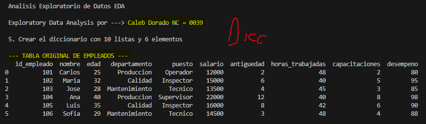
## 7. Convertir el DataFrame en archivo CSV
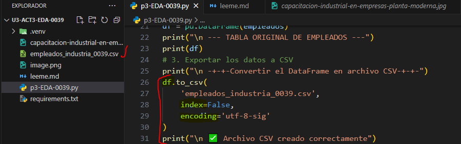
## Datos del CSV ---> Base de datos
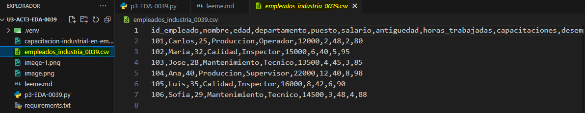
## 8. Leer los datos desde el archivo CSV
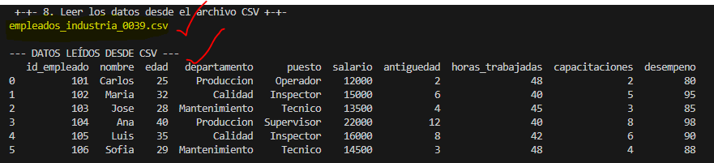
## 9. Análisis Exploratorio de Datos (EDA)
### Primeros y ultimos registros
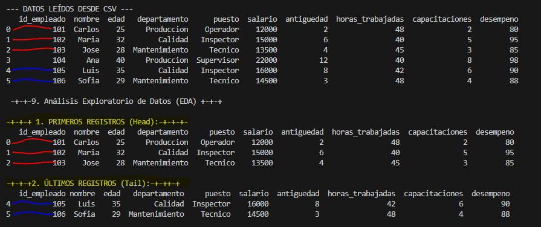

## 6. Dimensiones y estructura
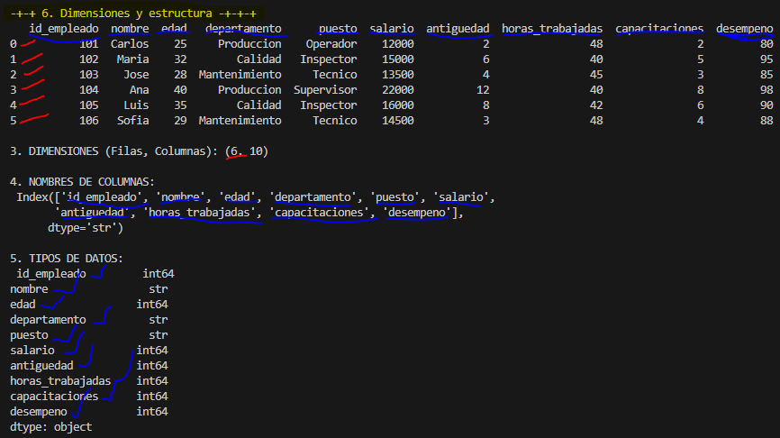
## Estadistica y limpieza
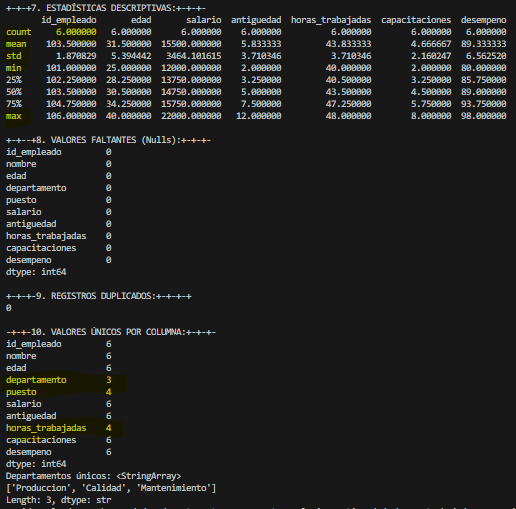
## 8 y 9. Ordenamiento, filtrado y agrupación
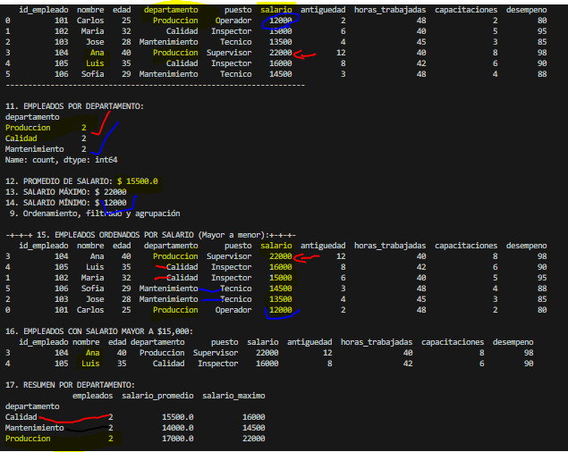
## 18. Gráfica de barras: Empleados por departamento
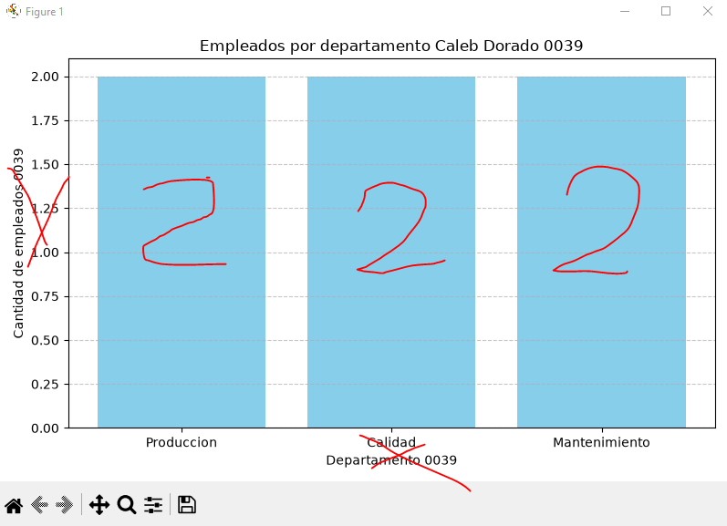
## 19. Grafica e barras: salarios pór empleado
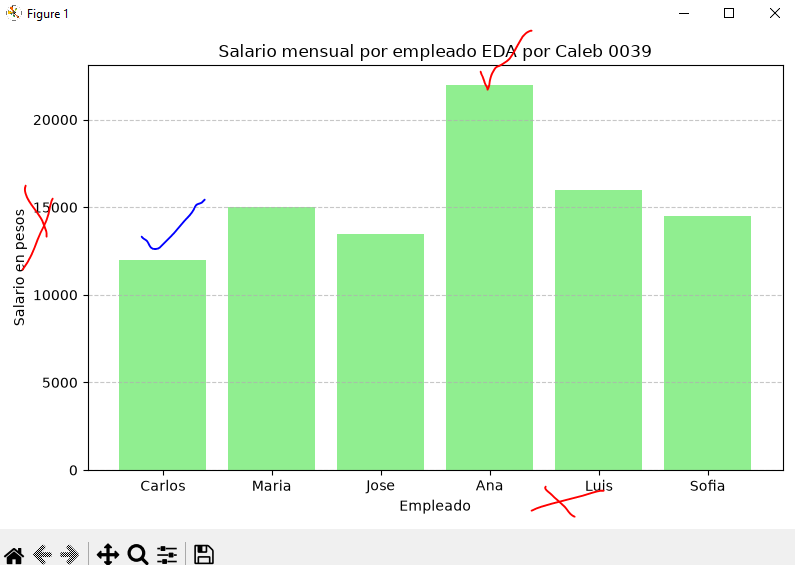
## 20. Histograma: Distribución de edades
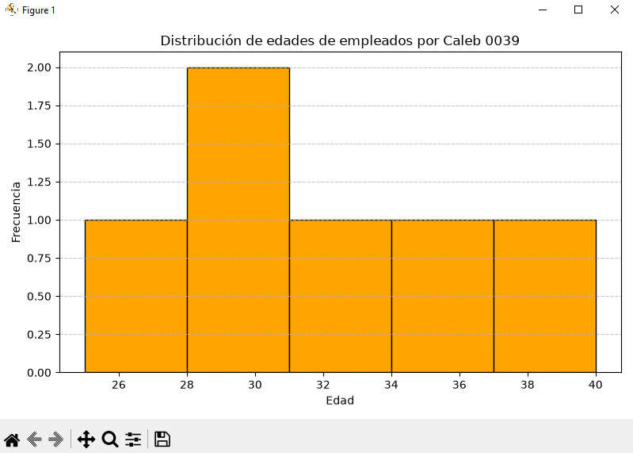
## 21. Gráfica de dispersión: Edad vs Salario
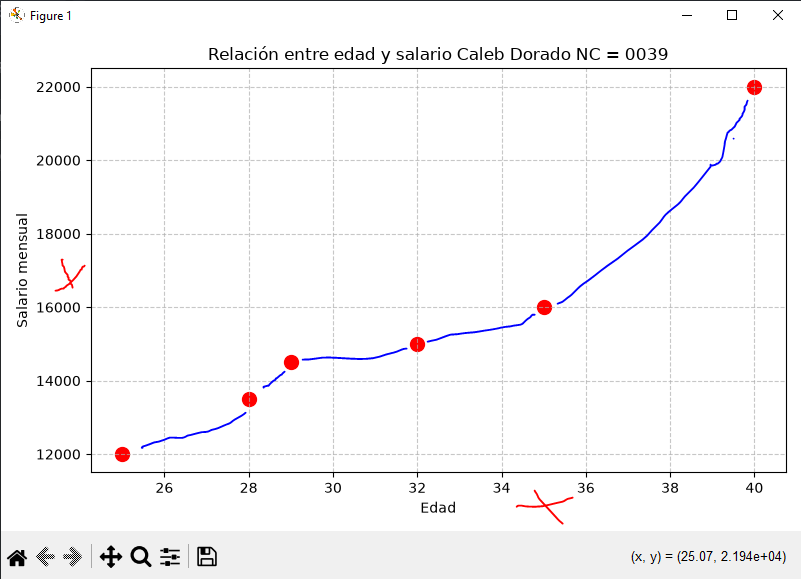
## 22. Diagrama de caja: Distribución de salarios
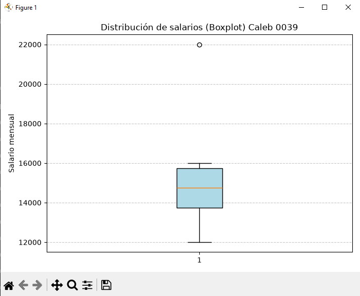
##  23. Matriz de correlación
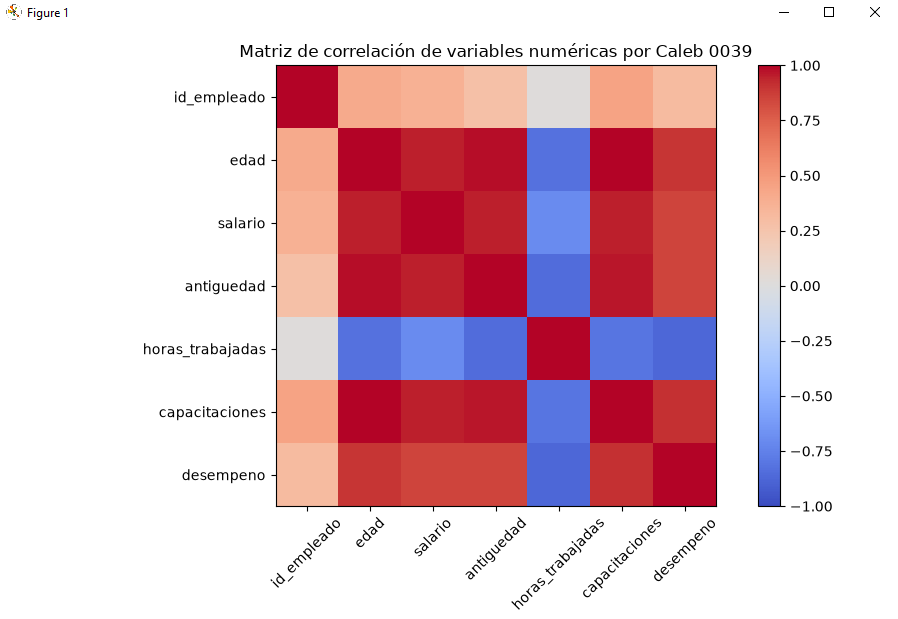