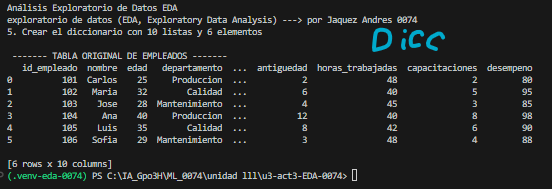
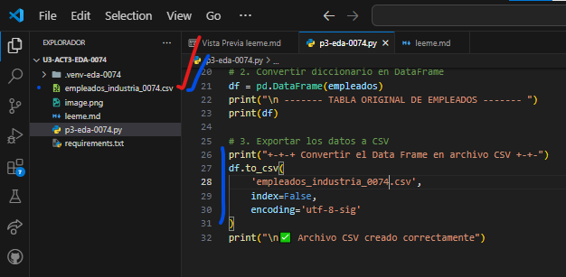
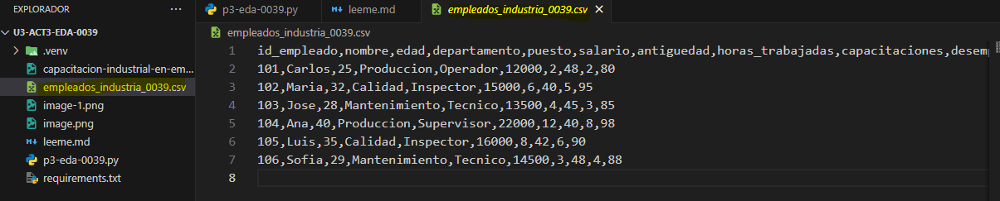
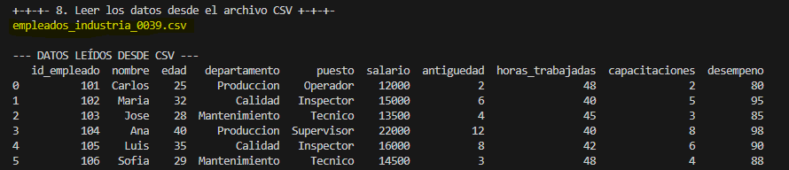
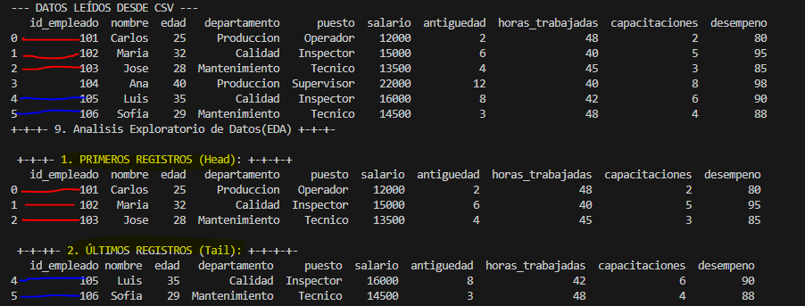
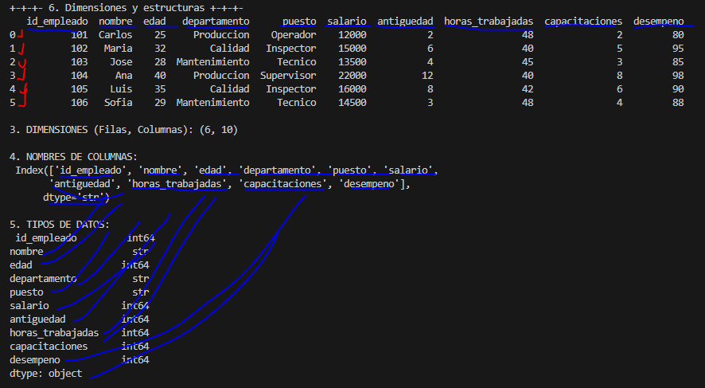

## 📊 UIII Act3: Importación y Descripción de Datos
## Caleb Dorado NC 0039 
> **🎓 Asignatura:** Soluciona problemas de Machine Learning  
> **📚 Nivel:** Tercer semestre de preparatoria  
> **🤖 Especialidad:** Inteligencia Artificial  
> **📈 Dificultad:** Cero a principiante  
> **🐍 Lenguaje:** Python  
> **🛠️ Herramientas:** Visual Studio Code, Pandas, Matplotlib y CSV  
## Empleados de industria
## 📊 UIII Act3: Importación y Descripción de Datos
## Jaquez Andres NC 0074 
> **🎓 Asignatura:** Soluciona problemas de Machine Learning  
> **📚 Nivel:** Tercer semestre de preparatoria  
> **🤖 Especialidad:** Inteligencia Artificial  
> **📈 Dificultad:** Cero a principiante  
> **🐍 Lenguaje:** Python  
> **🛠️ Herramientas:** Visual Studio Code, Pandas, Matplotlib y CSV  
## Empleados de industria

## TABLA ORIGINAL DE EMPLEADOS

##  7. Convertir el DataFrame en archivo CSV

## Datos del csv --> Base de datos

## 8. Leer los datos desde el archivo CSV

## 9. Análisis Exploratorio de Datos (EDA)
## primeros y ultimos registros

## 10. Dimensiones y estructura

## 11. Estadisticas y limpieza

## 12 y 13. (9. y 8. Ordenamiento, filtrado y agrupación)

## 14. Gráfica de barras: Empleados por departamento